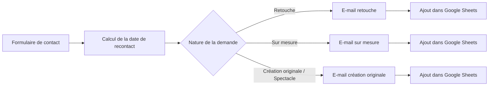

# Automatisation des demandes clients avec n8n

**Du formulaire de contact au suivi client : un workflow qui collecte les demandes, personnalise les réponses et centralise les informations dans Google Sheets.**

Ce projet illustre ma capacité à traduire un besoin métier en automatisation avec **n8n**, en combinant orchestration visuelle, intégrations Google et logique JavaScript.

Il s'appuie sur un cas d'usage dans le domaine de la couture : traiter les demandes de **retouche**, de **création sur mesure** et de **création originale / spectacle** pour l'activité MissByMisstinguette.

## Le besoin métier

À la réception d'une demande, plusieurs tâches se répètent : identifier la prestation souhaitée, accuser réception, recopier les coordonnées et définir une échéance de prise de contact.

L'objectif de ce workflow est de réduire ces manipulations et de fournir un point de suivi commun pour préparer les échanges avec les clients.

| Besoin | Réponse apportée par le workflow |
| --- | --- |
| Recueillir les informations utiles dès le premier contact | Formulaire n8n avec coordonnées, catégorie et description du projet |
| Adapter la réponse à la prestation demandée | Routage conditionnel vers trois modèles d'e-mail |
| Donner de la visibilité au client | Accusé de réception personnalisé envoyé via Gmail |
| Préparer le suivi des demandes | Ajout d'une ligne dans un tableau Google Sheets commun |
| Calculer une échéance de prise de contact | Script JavaScript ajoutant sept jours de semaine à la date de soumission |

## Vue d'ensemble

Les trois branches alimentent **la même feuille de suivi**. Chaque branche envoie d'abord l'e-mail, puis enregistre la demande.

## Fonctionnement détaillé

### 1. Collecter la demande

Le nœud **Formulaire contact** déclenche le workflow à chaque soumission et recueille :

- le nom et le prénom ;
- le numéro de téléphone ;
- l'adresse e-mail ;
- la nature de la demande ;
- une description libre du projet.

Le formulaire est fourni directement par n8n, ce qui permet de construire ce parcours sans développer d'interface dédiée.

### 2. Calculer une date de recontact

Le nœud **CalculDateContact** utilise JavaScript et l'objet `DateTime` de Luxon disponible dans n8n pour :

1. lire l'horodatage de soumission (`submittedAt`) ;
2. avancer d'un jour à la fois ;
3. compter uniquement les jours du lundi au vendredi ;
4. retourner l'échéance au format `dd-MM-yyyy`.

Le calcul exclut les week-ends ; les jours fériés ne sont pas pris en compte.

### 3. Orienter la demande

Le nœud **Demande client**, de type `Switch`, lit la première valeur du champ « Nature de votre demande » et sélectionne la branche correspondante :

| Catégorie | Traitement |
| --- | --- |
| Retouche | Accusé de réception adapté à une demande de retouche |
| Sur mesure | Accusé de réception adapté à la création d'une tenue sur mesure |
| Création originale/Spectacle | Accusé de réception adapté à un projet de costume ou de création originale |

### 4. Personnaliser l'accusé de réception

Les nœuds **Gmail** utilisent les expressions n8n pour récupérer le destinataire et son nom depuis le formulaire. Le contenu du message varie selon la catégorie choisie.

Cette étape automatise le premier retour au client tout en conservant un message contextualisé.

### 5. Centraliser les informations

Les nœuds **Google Sheets** ajoutent une ligne contenant les coordonnées, la catégorie et la description du projet. Les expressions référencent directement les nœuds sources pour retrouver les données du formulaire après l'envoi de l'e-mail.

**État du mapping dans l'export :** la branche Retouche renseigne séparément la date de demande et la date de recontact. Les branches Sur mesure et Création originale/Spectacle placent actuellement la date de recontact dans la colonne « Date de la demande ». Ce mapping est à harmoniser pour obtenir un suivi identique sur les trois parcours.

## Compétences mises en œuvre

| Compétence | Application dans le projet |
| --- | --- |
| **Analyse d'un besoin métier** | Décomposition du traitement d'une demande en étapes automatisables |
| **Orchestration avec n8n** | Construction d'un workflow de neuf nœuds, du déclenchement à l'enregistrement |
| **Logique conditionnelle** | Utilisation d'un `Switch` pour gérer trois parcours métier |
| **Intégration de services** | Connexion à Gmail et Google Sheets avec des credentials OAuth2 |
| **Manipulation de données** | Mapping des champs, expressions inter-nœuds et formatage des dates |
| **JavaScript dans un workflow low-code** | Implémentation d'un calcul de délai excluant les week-ends |
| **Communication automatisée** | Personnalisation des messages selon les informations saisies |

## Importer et essayer le workflow

### Prérequis

- Une instance n8n disposant des nœuds Form Trigger, Code, Switch, Gmail et Google Sheets utilisés dans l'export.
- Un compte Google permettant l'envoi d'e-mails via Gmail et l'accès à un document Google Sheets.
- Des credentials **Gmail OAuth2** et **Google Sheets OAuth2** configurés dans n8n.

### Installation

1. Télécharger le fichier [`FormAutomation.json`](./FormAutomation.json).
2. Dans n8n, importer le workflow depuis ce fichier.
3. Associer vos credentials aux **trois nœuds Gmail** et aux **trois nœuds Google Sheets**.
4. Dans chaque nœud Google Sheets, sélectionner votre document et votre feuille, puis vérifier le mapping des colonnes.
5. Adapter les textes des e-mails, la signature et le délai annoncé à votre activité.
6. Ouvrir l'URL de test du nœud **Formulaire contact** et soumettre une demande pendant l'écoute du déclencheur.
7. Après vérification des trois parcours, activer ou publier le workflow selon votre version de n8n et utiliser l'URL de production du formulaire.

L'export est fourni avec le workflow inactif. Les références de credentials présentes dans le JSON doivent être réassociées à votre instance.

### Structure de la feuille de suivi

Préparer les en-têtes suivants, puis vérifier leur correspondance dans les nœuds Google Sheets :

| Nom et Prénom | Numéro de téléphone | E-Mail | Demande | Description du projet | Date de la demande | Recontacter avant le |
| --- | --- | --- | --- | --- | --- | --- |

Le champ `Recontacter avant le ` contient un espace final dans l'export : en tenir compte lors du mapping ou harmoniser son nom dans n8n.

### Vérification du parcours

Pour chacune des trois catégories, soumettre une demande avec une adresse de test accessible, puis vérifier :

- que la branche attendue est exécutée ;
- que l'e-mail contient le bon nom et le texte associé à la prestation ;
- qu'une ligne est ajoutée à la feuille avec les informations saisies ;
- que le calcul de recontact exclut correctement les week-ends.

## Pistes d'évolution

- Harmoniser les colonnes de dates sur les trois branches et le délai annoncé dans les e-mails.
- Ajouter une notification interne à chaque nouvelle demande.
- Déclencher une relance à l'approche de la date de recontact.
- Ajouter un parcours de gestion des erreurs pour les échecs Gmail ou Google Sheets.
- Faire évoluer le tableau vers un suivi avec statuts : « À contacter », « En discussion », « Devis envoyé », « Clôturé ».

---

**Ce projet montre comment j'associe les capacités low-code de n8n à du code ciblé pour construire un parcours métier concret, de la collecte d'informations à la préparation du suivi client.**
